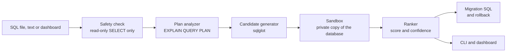

# QueryDoctor

**A SQL index advisor that proves every recommendation by measuring it.**

[](https://github.com/ContentbyShanu/querydoctor/actions/workflows/ci.yml)
[](LICENSE)
[](pyproject.toml)
[](pyproject.toml)
[](#quickstart)

> **Customers with pending orders: 3,865 ms to 0.11 ms** on a 1,020,000-row database.
> Measured, not estimated. Reproduce it with `querydoctor seed && querydoctor bench`.

**Live demo:** <https://contentbyshanu.github.io/querydoctor/> replays the real benchmark results in the dashboard. To analyze your own queries, run QueryDoctor locally (see [Quickstart](#quickstart)).

Slow queries are the most common production database problem, and most tools answer with
"add an index" and nothing else. QueryDoctor takes a different approach: it proposes candidate
indexes, **builds each one on a private copy of your database, times the query again, checks the
results are identical, measures what the index costs in disk space and insert speed**, and only
then recommends it, with ready-to-run migration SQL and a rollback.

## Contents

- [Quickstart](#quickstart)
- [How it works](#how-it-works)
- [Features](#features)
- [CLI examples](#cli-examples)
- [Dashboard](#dashboard)
- [REST API](#rest-api)
- [Benchmark results](#benchmark-results)
- [Design decisions](#design-decisions)
- [Project structure](#project-structure)
- [Quality](#quality)
- [Limitations](#limitations)
- [Roadmap](#roadmap)

## Quickstart

You need Python 3.11 or newer. No Docker, no database server, no API keys.

```bash
pip install -e .
querydoctor seed
querydoctor serve
```

Then open <http://127.0.0.1:8000>. Prefer a virtual environment? Create it first:

```bash
python -m venv .venv
.venv\Scripts\activate          # Windows (macOS/Linux: source .venv/bin/activate)
```

`querydoctor seed` builds a deterministic shop database of about one million rows with primary
keys only, which is exactly the situation where missing indexes hurt.

## How it works



1. **Validate.** The query is parsed with sqlglot and must be a single read-only `SELECT`.
2. **Diagnose.** `EXPLAIN QUERY PLAN` is parsed into findings: full scans of large tables,
   temporary sorts and groupings, joins without index support, and indexes SQLite builds at
   runtime.
3. **Propose.** Columns are classified (equality, range, join key, ordering, grouping, selected)
   and turned into single-column, composite, covering and partial index candidates.
   Composite order follows the rule *equality columns first, then one range column*.
4. **Prove.** Each candidate is created in a sandbox copy. QueryDoctor checks the plan really
   uses it, takes the median of repeated timings, compares a digest of the result set with the
   baseline, measures the insert-speed penalty and index size, then drops it again.
5. **Rank.** `score = log2(speedup) / (1 + 0.5 * write_overhead + 2 * size_ratio)`. Cost guards
   reject expensive indexes with small gains. A wider index replaces a narrower one it extends.
6. **Deliver.** A plain-English explanation of *why* each index helps, a confidence level, a
   migration script, and a rollback script.

The original database is opened read-only and never modified. Details are in
[docs/ARCHITECTURE.md](docs/ARCHITECTURE.md).

## Features

- **Proof, not guesses:** before/after timings, identical-result check, plan check
- **Honest costs:** index size on disk and measured slowdown of inserts for every recommendation
- **Index shapes:** single-column, composite (correct column order), covering and partial indexes
- **Multi-round search:** finds a second index when a join needs one, and merges redundant ones
- **Safe by construction:** read-only validation, sandbox copy, query-only connection
- **Plain-English explanations** and a confidence rating for each recommendation
- **Migration and rollback SQL**, de-duplicated across queries
- **Three interfaces:** CLI, REST API and a web dashboard
- **Reproducible benchmark suite** with a deterministic one-million-row dataset
- **Zero setup:** SQLite engine behind an interface that PostgreSQL can implement later

## CLI examples

```bash
querydoctor seed                              # create data/shop.db (about 1M rows)
querydoctor schema                            # tables, row counts, existing indexes
querydoctor analyze "SELECT id, total_cents FROM orders WHERE user_id = 1 ORDER BY created_at DESC LIMIT 20"
querydoctor analyze --file slow_queries.sql --migration migrations/001_indexes.sql
querydoctor report --format markdown          # re-print the last analysis
querydoctor report --format sql               # just the migration script
querydoctor bench                             # run the 10-query benchmark, update docs/benchmarks.md
querydoctor serve --port 8000                 # dashboard and REST API
```

A real run on the benchmark database:

```text
╭─ q1 ─────────────────────────────────────────────────────────────────────────────────────────────╮
│ SELECT id, total_cents, created_at FROM orders WHERE user_id = 1 ORDER BY created_at DESC LIMIT  │
│ 20                                                                                               │
╰──────────────────────────────────────────────────────────────────────────────────────────────────╯
  1 index recommended: 12 ms to 0.03 ms.
#  Index                                               Before  After    Gain  Size    Inserts  Trust
1  CREATE INDEX                                        12 ms   0.03 ms  437x  7.6 MB  +431%    high
   idx_orders_user_id_created_at_total_cents_cov ON
   orders (user_id, created_at, total_cents)
  1. Replaces a full scan of orders with a direct search on (user_id, created_at, total_cents). Rows
come out already in ORDER BY order, so the temporary sort is gone. The index holds every column the
query reads, so the table is not touched. Measured from 12 ms to 0.03 ms (437x faster). Costs 7.6 MB
of disk and makes inserts about 431% slower.
q1: 12 ms to 0.03 ms (437x faster)
```

Put several queries in a `.sql` file and label them with `-- name:` comments:

```sql
-- name: Customer order history
SELECT id, total_cents FROM orders WHERE user_id = 1 ORDER BY created_at DESC LIMIT 20;

-- name: Login by email
SELECT id, name FROM users WHERE email = 'user77777@example.com';
```

## Dashboard

`querydoctor serve` starts a dashboard with three views:

- **Analyze:** paste queries or pick an example. Each result shows the plan before and after,
  every recommendation with its measured cost, a table of **every candidate that was tried and
  why it was accepted or rejected**, and copy/download buttons for the migration and rollback SQL.
  A "vitals" strip draws one heartbeat for the old query and as many beats for the new plan as
  fit in the same amount of time, so the speedup is visible at a glance.
- **Benchmarks:** the latest `querydoctor bench` results on a log-scale latency chart.
- **Schema:** tables, row counts and the indexes that already exist.

The dashboard is plain JavaScript modules and CSS with no build step. The only HTML file in the
repository is `index.html`, the small host page for the GitHub Pages demo; the live server
generates its own boot document from Python
([ADR 0006](docs/adr/0006-dashboard-without-html-or-build-step.md)).

**Hosted demo.** GitHub Pages cannot run Python, so the demo loads the same dashboard code in
"static mode": it reads `docs/benchmarks.json` and replays the measured results for the ten
benchmark queries. To publish your own copy, open *Settings, Pages*, choose the `main` branch and
the `/ (root)` folder, and save.

## REST API

| Method and path | Purpose |
|---|---|
| `GET /api/health` | Server status, version, whether the database exists |
| `GET /api/schema` | Tables, row counts, columns and indexes |
| `GET /api/samples` | Ten ready-made slow queries |
| `GET /api/benchmarks` | Latest benchmark run with its environment |
| `POST /api/analyze` | Body `{"sql": "..."}`: up to 10 read-only queries, returns the full report |

Interactive documentation is served at `/api/docs`. Errors use standard status codes: `400`
for SQL that is not a read-only query, `409` when the database is missing, `422` for invalid
input and `429` while another analysis is running.

## Benchmark results

Ten realistic slow queries against a 1,020,000-row shop database (31.7 MB SQLite file).
Measured on SQLite 3.45.1, Python 3.12.3, Linux 6.18.44-fc-v180 (x86_64), single CPU core. Full methodology and the
queries are in [docs/benchmarks.md](docs/benchmarks.md).

| Query | Before | After | Speedup | Recommended indexes |
|---|---:|---:|---:|---|
| Customer order history | 12 ms | 0.03 ms | 355x | `CREATE INDEX idx_orders_user_id_created_at_total_cents_cov ON orders (user_id, created_at, total_cents)` |
| Pending orders this quarter | 17 ms | 4.2 ms | 4.1x | `CREATE INDEX idx_orders_created_at_where_status_pending ON orders (created_at) WHERE status = 'pending'` |
| Order line items | 19 ms | 0.01 ms | 2,176x | `CREATE INDEX idx_order_items_order_id ON order_items (order_id)` |
| Login by email | 3.7 ms | 0.01 ms | 348x | `CREATE INDEX idx_users_email ON users (email)` |
| Product rating summary | 3.0 ms | 0.01 ms | 305x | `CREATE INDEX idx_reviews_product_id_rating_cov ON reviews (product_id, rating)` |
| Bulk purchases of a product | 16 ms | 0.31 ms | 52x | `CREATE INDEX idx_order_items_product_id_quantity_order_id_cov ON order_items (product_id, quantity, order_id)` |
| Q1 revenue by customer | 26 ms | 7.2 ms | 3.6x | `CREATE INDEX idx_orders_status_created_at_user_id_total_cents_cov ON orders (status, created_at, user_id, total_cents)` |
| Refunded orders with customer | 18 ms | 2.7 ms | 6.5x | `CREATE INDEX idx_orders_created_at_where_status_refunded ON orders (created_at) WHERE status = 'refunded'` |
| Best sellers this quarter | 85 ms | 85 ms | 1.0x | none found that beats the 1.25x threshold |
| Customers with pending orders | 3,865 ms | 0.11 ms | 35,043x | `CREATE INDEX idx_orders_user_id_where_status_pending ON orders (user_id) WHERE status = 'pending'`<br>`CREATE INDEX idx_users_plan_created_at_where_country_sg ON users (plan, created_at) WHERE country = 'SG'` |

Total for the suite: **4,064 ms before, 99 ms after.**

Absolute timings depend on your machine, so compare the ratios.

**Why one query has no recommendation.** *Best sellers this quarter* (85 ms) is left alone on purpose. The only index that helps, `CREATE INDEX idx_order_items_order_id_product_id_quantity_cov ON order_items (order_id, product_id, quantity)`, makes it 1.9x faster but would more than double the cost of inserts, so the cost guard rejects it. The dashboard lists it under *Every candidate tested* with its measured numbers.

## Design decisions

| Decision | Why | Record |
|---|---|---|
| SQLite first, behind an `Engine` interface | Anyone can run it in a minute; PostgreSQL slots in later | [ADR 0001](docs/adr/0001-sqlite-first-behind-an-engine-interface.md) |
| Validate in a sandbox copy | Measure real behavior without touching real data | [ADR 0002](docs/adr/0002-validate-in-a-sandbox-copy.md) |
| Greedy multi-round search | Finds multi-index fixes without exponential cost | [ADR 0003](docs/adr/0003-greedy-multi-round-search.md) |
| Equality before range in composites | A b-tree cannot keep seeking after a range column | [ADR 0004](docs/adr/0004-composite-column-order.md) |
| Cost-aware scoring with guards | The fastest index is not always the best one | [ADR 0005](docs/adr/0005-scoring-and-cost-guards.md) |
| JavaScript and CSS dashboard, no build step | One toolchain, nothing to compile | [ADR 0006](docs/adr/0006-dashboard-without-html-or-build-step.md) |

## Project structure

```text
querydoctor/
├── src/querydoctor/
│   ├── ingest.py        split SQL scripts and query logs
│   ├── safety.py        read-only SELECT validation
│   ├── engine.py        Engine protocol and the SQLite implementation
│   ├── analyzer.py      plan parsing and findings
│   ├── candidates.py    index candidate generation (sqlglot)
│   ├── sandbox.py       private copy, create / measure / drop
│   ├── ranker.py        scoring, confidence, explanations
│   ├── advisor.py       multi-round pipeline and report assembly
│   ├── migrations.py    migration and rollback SQL
│   ├── bench.py         the 10-query benchmark suite
│   ├── seed.py          deterministic data generator
│   ├── reporting.py     JSON and Markdown output
│   ├── api.py           FastAPI application
│   ├── cli.py           Typer commands
│   └── web/             dashboard (ES modules, CSS, boot document generator)
├── index.html           host page for the GitHub Pages demo (static mode)
├── tests/               unit and integration tests against real SQLite databases
├── docs/                ARCHITECTURE.md, benchmarks.md, adr/
├── .github/             CI workflow, issue and pull request templates
├── pyproject.toml  Makefile  LICENSE  CONTRIBUTING.md  CODE_OF_CONDUCT.md  SECURITY.md
└── .env.example  .editorconfig  .gitignore
```

## Quality

- **158 tests**, 97% line and branch coverage (CI requires 85%)
- `ruff` for linting and formatting, `mypy --strict` for types
- CI on Linux and Windows with Python 3.11, 3.12 and 3.13, plus a syntax check of every
  dashboard module
- Integration tests run against real SQLite databases, including proof that the original file is
  never modified and that every sandbox index is dropped

```bash
pip install -e ".[dev]"
pytest --cov
```

## Limitations

- **SQLite only.** Recommendations come from SQLite's planner and do not transfer to PostgreSQL
  or MySQL.
- **Greedy search.** Each candidate is measured on its own, so indexes that only help as a pair
  can be missed.
- **Not every predicate is understood.** Conditions under `OR`, expressions such as
  `lower(email) = ...` and `LIKE` patterns are not turned into index columns yet.
- **Statistics are sampled.** Selectivity is estimated from the first 50,000 rows of a table.
- **Write cost is synthetic.** Insert overhead comes from a rolled-back batch insert, which is a
  relative indicator, not a throughput forecast.
- **Timings are local.** Results depend on hardware and SQLite version; the ratios are what to
  compare.
- **Size.** Analysis copies the database, which suits development-size data; multi-gigabyte
  files will be slow to copy.

## Roadmap

- PostgreSQL engine (`EXPLAIN (ANALYZE, BUFFERS)`, sandbox database, `CREATE INDEX CONCURRENTLY`)
- Pairwise candidate search for indexes that only help together
- Expression indexes, `OR` predicates and prefix `LIKE`
- Detection of unused and duplicate existing indexes
- Query-log capture (including `pg_stat_statements`) as an input source
- A CI check command that fails a pull request when a new query introduces a full scan

## Contributing

Contributions are welcome. See [CONTRIBUTING.md](CONTRIBUTING.md) and the
[code of conduct](CODE_OF_CONDUCT.md). Security issues: [SECURITY.md](SECURITY.md).

## License

[MIT](LICENSE)
