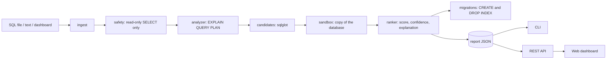

# Architecture

QueryDoctor answers one question with evidence: *which index would make this query faster, and
what would it cost?* Everything is organized around measuring instead of guessing.

## Data flow



## Modules

| Module | Responsibility |
|---|---|
| `ingest.py` | Split SQL scripts and query logs into queries; read `-- name:` titles |
| `safety.py` | Parse with sqlglot; allow exactly one read-only query |
| `engine.py` | `Engine` protocol and the SQLite implementation: schema, plans, timing, indexes |
| `analyzer.py` | Turn plan rows into findings: full scans, temp sorts, automatic indexes, joins |
| `candidates.py` | Classify columns (equality, range, join, order, group, selected) and propose indexes |
| `sandbox.py` | Private database copy; create, measure and drop each candidate |
| `ranker.py` | Score, confidence, cost guards and plain-English explanations |
| `advisor.py` | The multi-round pipeline that ties everything together and builds the report |
| `migrations.py` | De-duplicate recommendations and write up/down SQL |
| `bench.py` | The fixed ten-query benchmark suite |
| `seed.py` | Deterministic e-commerce data generator (about one million rows) |
| `reporting.py` | JSON persistence and Markdown rendering |
| `api.py` | FastAPI app: REST endpoints and the dashboard host |
| `cli.py` | Typer commands: `seed`, `analyze`, `report`, `bench`, `schema`, `serve`, `version` |
| `web/` | Boot document generator and the static dashboard (ES modules and CSS) |

## The advisor pipeline

For each query:

1. **Validate.** `validate_readonly` rejects anything but a single read-only query.
2. **Baseline.** `EXPLAIN QUERY PLAN` gives the plan and findings; the query is timed (one
   warm-up, then 3 to 7 runs, median) and its result set digested.
3. **Skip if fast.** Queries under 1 ms are reported as already fast.
4. **Rounds.** Up to three times: generate candidates against the current sandbox state, evaluate
   each, apply cost guards, accept the best, and re-measure. A wider index that extends an
   accepted one replaces it.
5. **Report.** Recommendations (with measured before/after, size, write overhead, confidence,
   explanation, SQL), plus every candidate that was tried and why it was or was not chosen.

After all queries the migration writer merges identical indexes across queries and emits the
migration and rollback scripts.

## Evaluating one candidate

```
write cost without index  ->  CREATE INDEX  ->  ANALYZE index  ->  read the plan
        |                                                            |
        |                                          planner ignored it? -> NOT_USED, drop, stop
        v                                                            v
write cost with index  ->  time the query  ->  compare result digest  ->  DROP INDEX
```

Size is the change in used pages (`page_count - freelist_count`), so dropped indexes do not
distort later measurements. Insert cost is the time to insert a batch copied from the table
inside a transaction that is rolled back.

## Safety invariants

1. User SQL passes `validate_readonly` before it runs.
2. The original database is opened read-only; analysis happens on a temporary copy.
3. The sandbox connection is `query_only` whenever user SQL runs; writes are enabled only inside
   the `writable()` context used for index management and the insert-cost measurement.
4. Every index created in the sandbox is dropped in a `finally` block.
5. The API never takes a file path from the client.

## Adding a database engine

Implement the `Engine` protocol (`tables`, `explain`, `measure`), and provide the index
inspection and sandboxing operations that `SQLiteEngine` and `Sandbox` currently offer. A
PostgreSQL engine would use `EXPLAIN (ANALYZE, BUFFERS, FORMAT JSON)`, a throwaway database
created from a template copy, and `CREATE INDEX CONCURRENTLY` in `migrations.py`. The candidate
generator, ranker and dashboard need no changes.

## Concurrency

The API runs analysis in FastAPI's thread pool and allows one analysis at a time; a second
request receives HTTP 429. Each analysis owns a private sandbox, so there is no shared mutable
state.

## Dashboard

`app.js` renders the shell and a hash router (`#/analyze`, `#/benchmarks`, `#/schema`). Views
live in `views/`, shared building blocks in `views/report.js`, SVG drawing in `charts.js`.
The "vitals" strip draws one heartbeat for the old query and as many beats for the new plan as
fit in the same time window, so speedup is visible at a glance.
